<div align="center">


# Gitphin Droid

### Git hosting in your pocket: a Git server with a web UI that runs on your Android phone.

Gitphin Droid keeps your Git repositories on the phone and serves them to plain `git` over a
USB cable, USB tethering or Wi-Fi. Open the app, `git push`, and browse code, commits, diffs,
issues, pull requests and a wiki in the app or on the PC at <http://127.0.0.1:8080>. No server,
no cloud, no account.

[](https://github.com/Adhamura/gitphinDroid/actions/workflows/ci.yml)
[](https://github.com/Adhamura/gitphinDroid/releases)
[](https://github.com/Adhamura/gitphinDroid/releases)
[](LICENSE)


[**Download the APK**](https://github.com/Adhamura/gitphinDroid/releases/latest) ·
[Screenshots](#screenshots) · [Why](#why-gitphin-droid) · [Install](#install) ·
[Connect a PC](#connect-a-pc) · [FAQ](#faq)

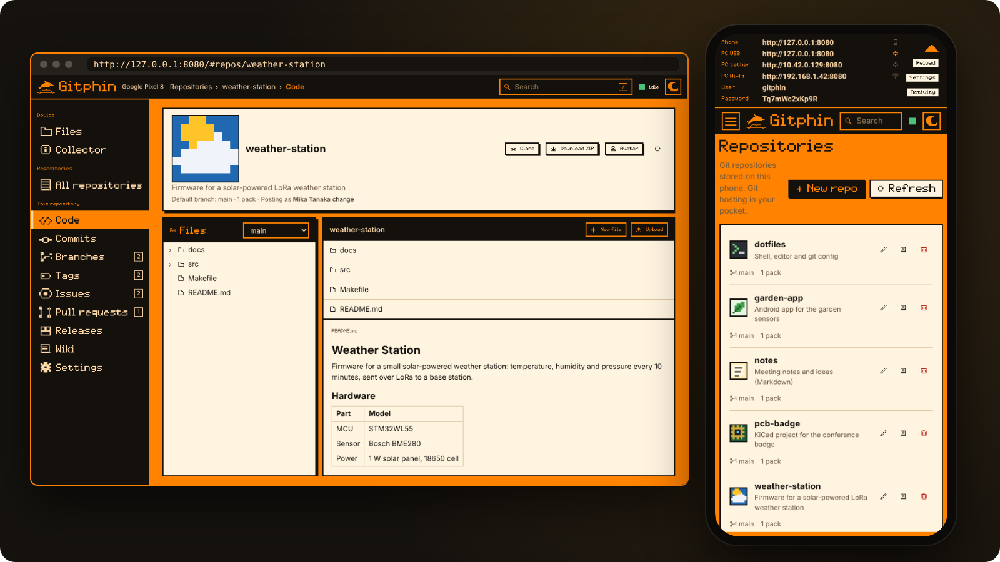

</div>

> [!NOTE]
> This is the Android port of [Gitphin](https://github.com/Adhamura/Gitphin), the Git server for
> the Flipper Zero. It uses the same C core and the same web UI. It is an independent
> open-source project. Git is a trademark of the Software Freedom Conservancy.

## Why Gitphin Droid

Your code usually lives on a laptop and on a server somewhere. Gitphin Droid adds a third place
you always carry: your phone. It is a real Git remote with a Gitea-like web UI, running on the
phone itself, reached from the PC over the cable or the local network.

- **📱 A Git server on the phone.** `git clone`, `pull` and `push` work with the `git` you
  already have (smart HTTP, and WebDAV like on the Flipper). A repo is made on the first push.
- **🌐 A full web UI.** Code browser with Markdown READMEs and syntax highlighting, commits,
  diffs, branches, tags, search, file edits and uploads, **issues**, **pull requests** with
  merge, **releases** and a **wiki**. In the app's own WebView and in any browser.
- **🔌 Three ways to connect, all shown in the app.** USB cable with the `gitphin-usb` helper
  (no password), USB tethering (no PC software, no password) or Wi-Fi (opt-in, user name and
  password, also as `gitphin.local`). The top bar lists every address and lights up the link in
  use; a QR code opens the Wi-Fi address on another device.
- **📊 Live transfers.** A push or clone shows its progress, objects, size and speed in the app
  and in the notification. The recent activity list keeps each push, pull and upload.
- **🖼️ Repo avatars, Download ZIP, Collector.** A picture per repo, a ZIP of any branch made on
  the phone, and a tab with the phone's device, memory, IPs, networks and Wi-Fi.
- **🔔 Webhooks** after each push, signed with HMAC-SHA256 when you set a secret.
- **🤖 Android extras.** Share sheet (send files from other apps to a repo), home-screen widget,
  quick-settings tile, start with the phone, a choice of the repos folder, a first-start guide,
  dark theme, and a pixel-style UI with a size setting.
- **🗂️ Plain Git repos.** Each repo is an ordinary bare repository. Copy it to any PC and use it
  there; issues and wiki live next to it as plain JSON and Markdown.
- **🪶 Small and open.** Plain C core, Java with no AndroidX and no third-party libraries, no
  analytics, MIT licensed. Nothing goes to the internet except the optional update check and
  the webhooks you set.

## Screenshots

### On the phone

<table>
  <tr>
    <td width="25%">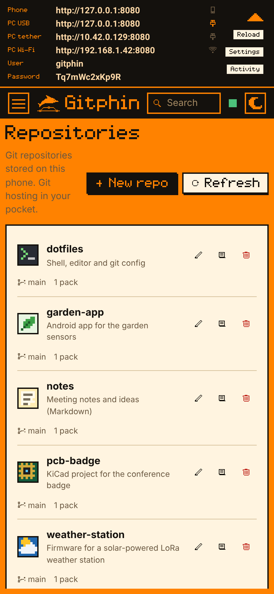<br><b>Main screen</b>: every address, the link in use lit (here: USB cable), repos with avatars</td>
    <td width="25%">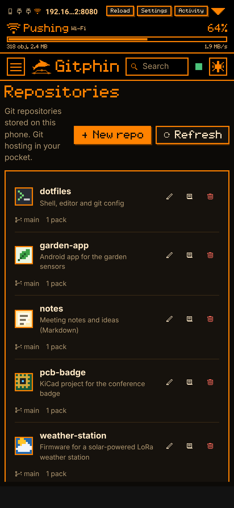<br><b>Live push</b>: progress, objects, size and speed, via Wi-Fi (dark theme)</td>
    <td width="25%">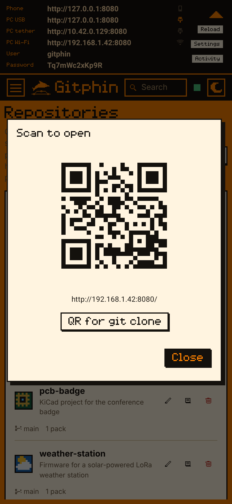<br><b>QR code</b>: open the Wi-Fi address, or a <code>git clone</code> URL, on another device</td>
    <td width="25%">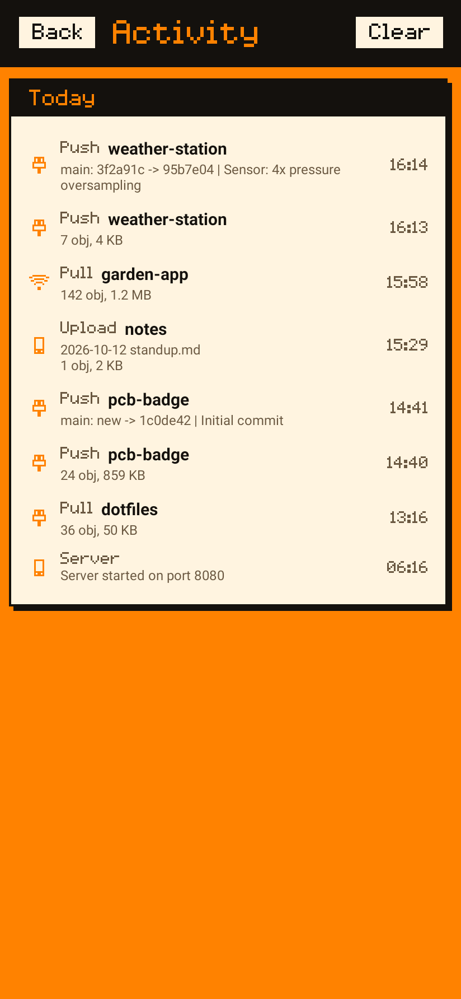<br><b>Activity</b>: pushes, pulls and uploads, with the link each one came over</td>
  </tr>
  <tr>
    <td>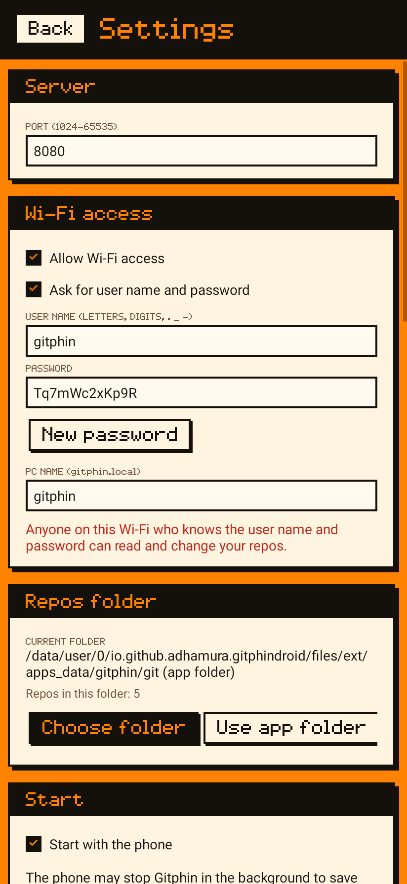<br><b>Settings</b>: port, Wi-Fi access and sign-in, <code>gitphin.local</code> name, repos folder</td>
    <td>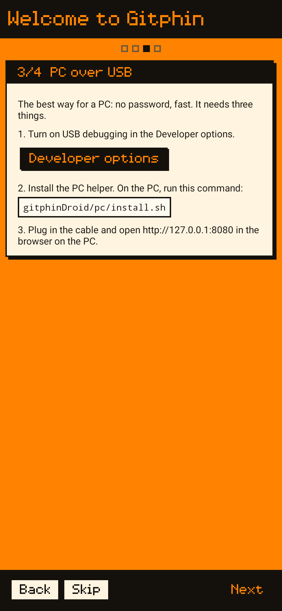<br><b>Guide</b>: how to connect a PC, step by step</td>
    <td>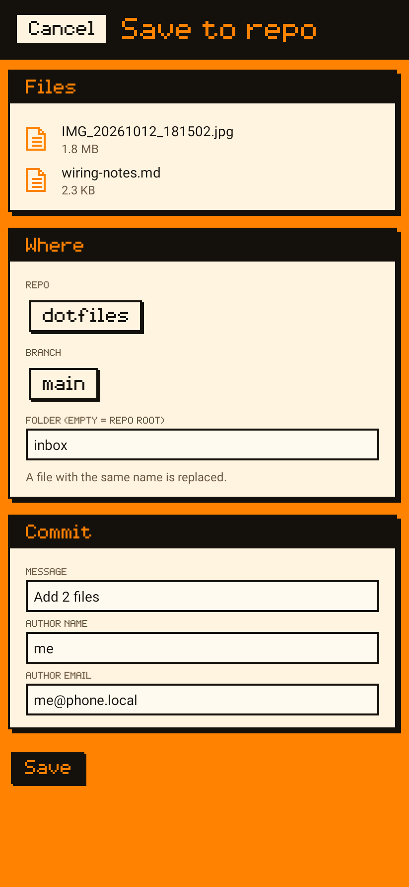<br><b>Share</b>: save files from any app into a repo, as a commit</td>
    <td>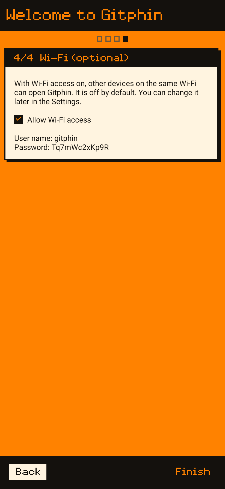<br><b>Wi-Fi</b>: off by default; user name and password when on</td>
  </tr>
</table>

<p align="center">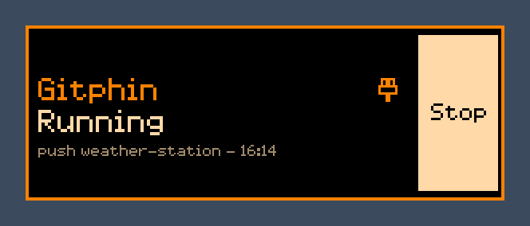<br>
<b>Widget</b>: state, link in use and the last push; start and stop from the home screen</p>

### In the browser

<table>
  <tr>
    <td width="50%">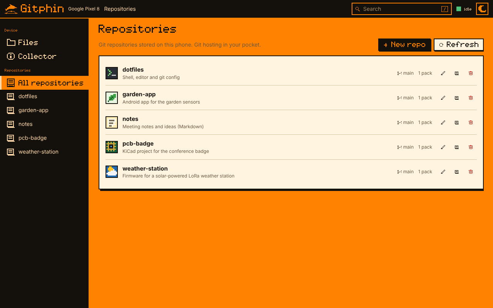<br><b>Repositories</b>: every repo on the phone, with avatars; create, rename, describe, delete</td>
    <td width="50%">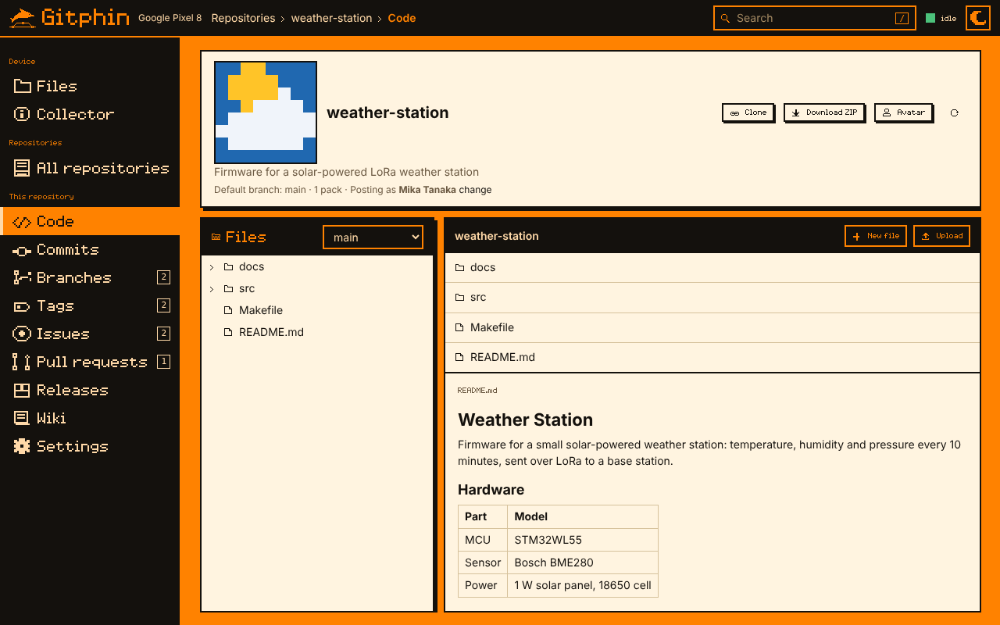<br><b>Code</b>: files, README, clone URL, <b>Download ZIP</b>; the dot at the top right is the link to the phone</td>
  </tr>
  <tr>
    <td>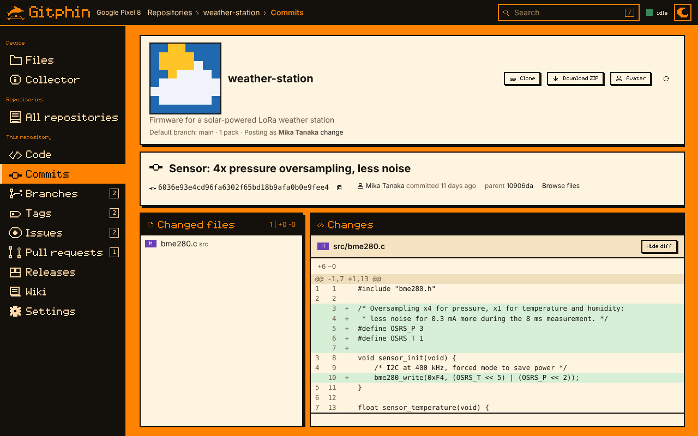<br><b>Diffs</b>: changed files and line diffs</td>
    <td>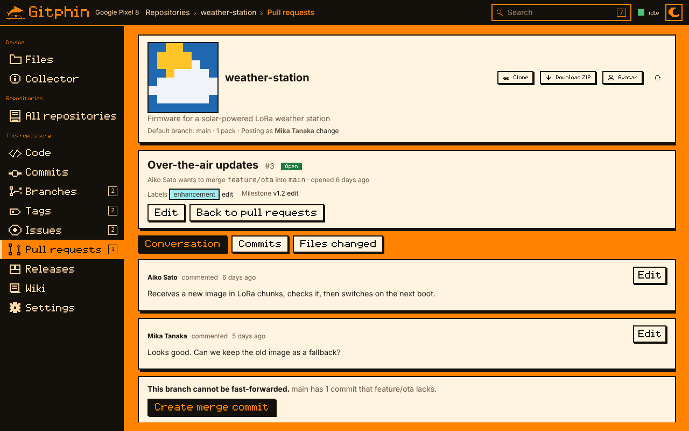<br><b>Pull requests</b>: conversation, commits, files changed, merge on the phone</td>
  </tr>
  <tr>
    <td>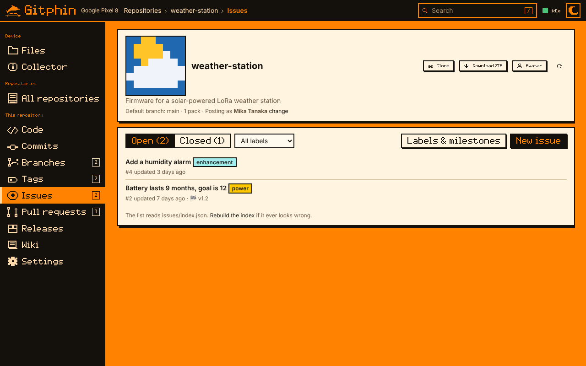<br><b>Issues</b>: labels, milestones, comments, open / closed</td>
    <td>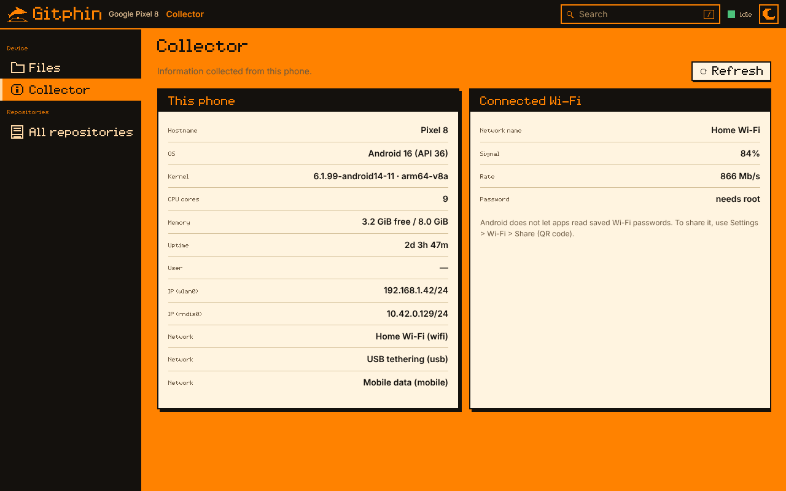<br><b>Collector</b>: the phone's device, memory, IPs, networks and Wi-Fi</td>
  </tr>
  <tr>
    <td>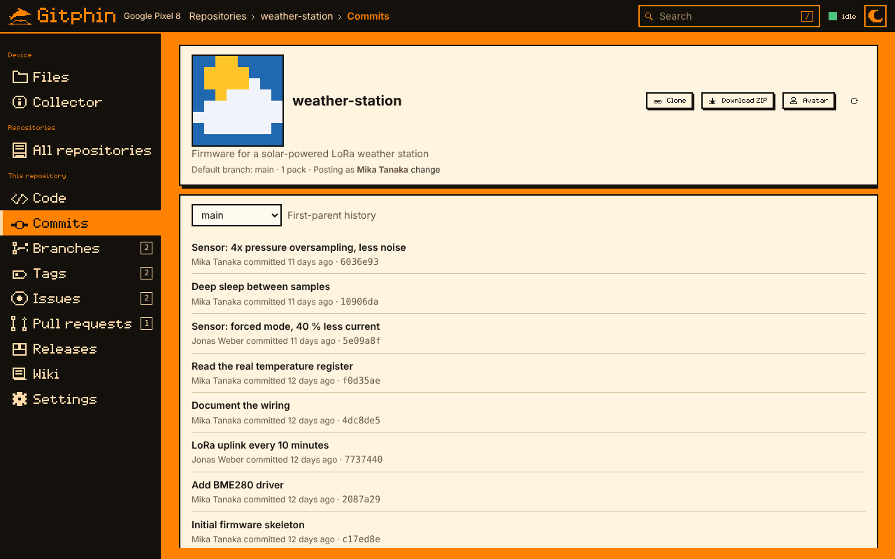<br><b>Commits</b>: history per branch, authors, short SHAs</td>
    <td>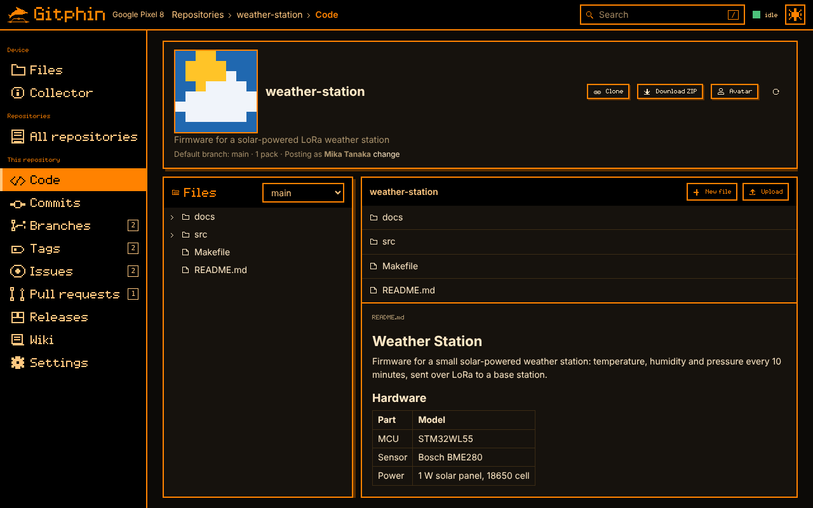<br><b>Dark theme</b>: follows the system, or switch it in the header</td>
  </tr>
</table>

<sub>Screenshots show made-up demo repositories. The browser pictures come from the real server
(<code>gitphind</code>, the Linux build of the app's server); the phone pictures are the app's
real screens, drawn by Robolectric. Both are made by <code>tools/screenshots/capture.sh</code>.</sub>

## How it compares

These are the usual ways to keep a portable or private Git remote:

| | **Gitphin Droid** | [Gitphin](https://github.com/Adhamura/Gitphin) on a Flipper Zero | Bare repo on a USB stick | Gitea / Forgejo in Termux | GitHub / GitLab |
|---|:--|:--|:--|:--|:--|
| Lives on a device you already carry | ✅ phone | ✅ Flipper | ➖ extra stick | ✅ phone | — |
| Works offline, no internet | ✅ | ✅ | ✅ | ✅ | ❌ |
| Plain `git clone` / `pull` / `push` | ✅ HTTP | ✅ HTTP | ✅ file path | ✅ | ✅ |
| Web UI: code, commits, diffs | ✅ | ✅ | ❌ | ✅ | ✅ |
| Issues, pull requests, releases, wiki | ✅ | ✅ | ❌ | ✅ | ✅ |
| Install: one app, no command line | ✅ APK | ➖ app + Linux bridge | ✅ | ❌ Termux setup | ✅ |
| Over a USB cable | ✅ | ✅ | ✅ | ➖ by hand | ❌ |
| Repos are normal bare repos you can copy | ✅ | ✅ | ✅ | ✅ | ❌ export |
| Webhooks | ✅ | ❌ | ❌ | ✅ | ✅ |
| Users, permissions, SSH, CI | ❌ | ❌ | ❌ | ✅ | ✅ |
| Big repos (hundreds of MB) | ➖ not tested at that size | ❌ a few MB | ✅ | ✅ | ✅ |

<sub>✅ yes · ➖ partial, or depends on setup · ❌ no. Based on each tool's public documentation;
corrections are welcome in an issue. Gitea, Forgejo and the cloud services are far bigger
products. Gitphin Droid is for people who want their own Git remote, with a real UI, in their
pocket.</sub>

## Requirements

- **Android 7.0 (API 24)** or newer, any phone or tablet (arm64, armv7 or x86_64).
- **On the PC:** `git` and a browser. Any OS works over USB tethering or Wi-Fi.
- **Optional, for the USB cable:** a Linux PC with Python 3 and `adb` for the `gitphin-usb`
  helper, and USB debugging on the phone.

## Install

### 1. The app

1. Download `gitphinDroid-<version>.apk` from
   [**Releases**](https://github.com/Adhamura/gitphinDroid/releases/latest).
2. Open the file on the phone. Android asks you to allow installs from this source (the
   browser or file manager you used). Turn it on ("Allow from this source"). This is the
   normal setting for apps outside Google Play.
3. Open Gitphin and follow the guide.

Check the download with `sha256sum -c SHA256SUMS --ignore-missing`. Every release is signed
with the same key, so updates install over the old version.

### 2. The PC helper (optional, USB cable)

On the phone, turn on Developer options > USB debugging. On the PC (Linux, Python 3, `git`,
`adb`) download `gitphin-usb-<version>.tar.gz` from the same release, then:

```bash
tar xzf gitphin-usb-*.tar.gz && cd gitphin-usb-*
./install.sh            # systemd user service, no sudo
./install.sh --uninstall
```

When you plug in the phone, `gitphin-usb` links `http://127.0.0.1:8080` on the PC to the phone
(`adb forward`) and starts the app if needed. If 8080 is busy (for example, the Flipper
bridge), it uses 8081 and up. Without the helper, use USB tethering or Wi-Fi.

## Connect a PC

| Link | Address on the PC | Password | PC software |
|---|---|---|---|
| 📱 **On the phone** | the app itself, `http://127.0.0.1:8080` | no | none |
| 🔌 **USB cable** (first choice) | `http://127.0.0.1:8080` | no | `gitphin-usb` (Linux) |
| 🔌 **USB tethering** (second choice) | `http://<tether IP>:8080`, shown in the app | no | none, any OS |
| 📶 **Wi-Fi** (opt-in) | `http://<phone IP>:8080` or `http://gitphin.local:8080` | yes (HTTP Basic) | none, any OS |

The top bar of the app and the notification show the addresses in this order, and light up the
link of the last request. In the web UI, the dot at the top right shows the link state: idle,
working, or not answering. When Wi-Fi access is off, Wi-Fi clients get 403. `gitphin.local`
works on most PCs (Windows 10+, macOS, Linux with Avahi); if it fails, use the IP address.

```bash
# put an existing repo on the phone (the repo is made on the first push)
git remote add phone http://127.0.0.1:8080/git/<name>.git
git push phone main --tags

# clone, pull, push as usual
git clone http://127.0.0.1:8080/git/<name>.git

# over Wi-Fi: any user name unless you set one in Settings
git clone http://gitphin:<password>@<phone-ip>:8080/git/<name>.git
```

## How it works

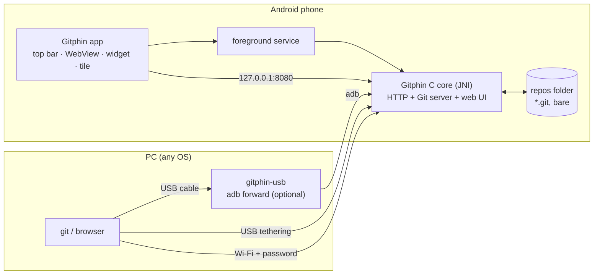

The Git server and the web UI are the C core of [Gitphin](https://github.com/Adhamura/Gitphin),
copied unchanged into `core/`. On the Flipper, the core uses furi, the Storage API and a USB
link. Here, the **port layer** in `port/` replaces those parts with POSIX code and a TCP
transport, and the Java app starts it as a foreground service over JNI. The WebView and any
browser talk to the same server.

<details>
<summary>Layout, the port layer, webhooks and the Collector</summary>

### Layout

| Path | What it is |
|---|---|
| `core/` | The Gitphin C core, copied from `gitphin/flipper_app/src/*/` (flat) by `sync_core.sh`, with a few marked patches, plus the web UI (`core/files/`). CMake compiles only the unit files, which `#include` their parts. |
| `port/` | The port layer. It replaces the Flipper firmware parts (see below). |
| `port/include/` | The furi, Storage and toolbox shim headers, and `port.h` (the public port API). |
| `port/platform/` | `furi.c`, `storage.c`, `plugin.c`: furi, Storage and the plugin table on POSIX. |
| `port/net/` | The TCP transport: `transport.c` (worker side), `acceptor.c`, `auth.c`, `peer.c`, `pc_routes.c`, `net_int.h`. |
| `port/server/` | `server.c` (worker), `jni.c`, `host_main.c`, `hooks.c` + `port_hooks.h` (the hooks `sync_core.sh` adds to `hub_http.c`). |
| `port/features/` | What the port adds: `smart/` (smart HTTP), `zip/` (also `GET /pc/zip`), `webhook/`, `avatar/` (stored as `hub/avatar.png`, the file the page uses). |
| `port/web/` | `core.js` and `phone_texts.js`, served as `/port/extra.js`: only the phone wording (Flipper words become phone words). ZIP, avatars and highlighting come from the Gitphin 1.2 page. |
| `CMakeLists.txt` | Builds `libgitphin.so` (Android, `-DGITPHIN_ANDROID=ON`) or `gitphind` (Linux test server). |
| `android/` | The app: Java, no AndroidX, no third-party libraries. |
| `pc/` | The PC helper `gitphin-usb` (USB link), `collector.py`, `install.sh`. |
| `tests/` | End-to-end tests with real `git` against `gitphind`, the Linux build of the server (ASan and UBSan). |
| `tools/screenshots/` | The README screenshots: demo repos, `gitphind` + Chromium for the web UI, Robolectric for the app's screens. |

### What the port replaces

| Flipper | Android |
|---|---|
| `furi.h`, `furi_hal.h`, Storage API | `port/include/` + `port/platform/furi.c`, `storage.c` (POSIX; `/ext` = the app's `files/ext`) |
| USB CDC frames + PC bridge (`hub_transport.c`, `bridge.py`) | `port/net/`: TCP sockets, spare-connection handling, Basic auth for non-loopback clients |
| `.fal` plugins loaded on demand (`hub_plugin.c`) | `port/platform/plugin.c`: all plugins linked in |
| App, screen and worker (`gitphin.c`) | `port/server/server.c` (worker thread) + `port/server/jni.c` + the Android service |
| Guarded allocator (`hub_mem.c`) | Off (`HUB_MEM_RAW`); the phone has no 256 KB heap |

### Webhooks

After a push changes branches or tags, the app sends a JSON message with `POST` to the URLs in
Settings > Webhooks (http or https, also on the LAN). It works for all three ways to push: dumb
WebDAV push, smart HTTP and the web UI API. The API routes `create` and `delete` send
`repo_created` and `repo_deleted`.

```json
{"event":"push","repo":"wh","refs":[{"ref":"refs/heads/main","before":"0000000000000000000000000000000000000000","after":"95575243fe82e071ab528250b121c7933c399677"}],"head_commit":{"id":"95575243fe82e071ab528250b121c7933c399677","message":"first commit","author":"t","time":1791899085},"via":"phone","server":"gitphin","time":1791899085}
```

The C side (`port/features/webhook/webhook.c`) compares the refs before and after each request
and calls `NativeServer.onEvent`. `WebhookSender` merges the events of one repo that come within
2 s, then posts them with `Content-Type: application/json`, `User-Agent: gitphin-droid`,
`X-Gitphin-Event`, `X-Gitphin-Delivery` and, when a secret is set,
`X-Gitphin-Signature-256: sha256=<HMAC-SHA256 of the body>`. Timeout 10 s; on failure it
retries after 2, 8 and 30 s. Test on the PC: `tests/run_webhook_test.sh`
(`gitphind --webhook-log FILE` writes each event as one line).

### Collector tab

The Collector tab shows the computer that runs the browser, as with the Flipper bridge:
- In a PC browser over USB, `gitphin-usb` answers `/pc/hub`, `/pc/info` and `/pc/wifi` with
  `pc/collector.py` (the same file as in Gitphin). `/pc/hub` is the link state for the status dot.
- In the app (or over USB tethering or Wi-Fi), the phone answers with its own data: device,
  Android, memory, IPs, networks and Wi-Fi. The Wi-Fi name needs the location permission
  (Settings > Collector). Android does not let apps read saved Wi-Fi passwords.

On the phone, a separate accept thread answers the `/pc/` routes, so the status dot stays right
while a long Git request runs.
</details>

## Updating

The app checks GitHub for a newer release at most once a day when you open it, and in
Settings > About with "Check for updates". When there is a new version, a dialog shows the
release notes. Tap "Download and install": the app downloads the APK from the release, then
Android asks you to confirm the install. Android only accepts the update when it is signed with
the same key. You can skip a version, or turn off the automatic check in Settings > About.
The check sends one request to `api.github.com` and nothing else.

## Limitations

- **One request at a time**, like on the Flipper. It is much faster here, but two PCs pushing at
  once wait for each other.
- **Plain HTTP.** Over Wi-Fi the password and the code travel unencrypted: use Wi-Fi access only
  on networks you trust. USB cable and tethering need no password.
- **No users or permissions.** One user name and password for Wi-Fi; issues and comments carry
  a name you set once in the browser.
- **Merge on the phone** is a tree merge: it works when the two branches changed different
  files. Changes to the same file are a conflict; merge those on the PC and push.
- **Web edits** are limited to files up to 64 KB, issues and wiki pages to 64 KB each. Search
  skips files over 64 KB; compare and merge walk at most 500 commits.
- **No SSH, LFS, CI, blame or activity graphs.**
- **Android may stop the server** in the background on some phones (see [Tips](#tips)).

## Tips

- **Allow background running** in Settings > Start. On Xiaomi/HyperOS, also set Battery saver to
  "No restrictions" and turn on Autostart.
- **Choose a shared repos folder** (Settings > Repos folder) if you want the repos to survive an
  uninstall, or back up with `git clone --mirror`.
- **Use the cable when you can.** `gitphin-usb` needs no password and keeps everything on
  `127.0.0.1`.
- **Show the QR code** (tap a Wi-Fi address in the top bar) to open the web UI on a tablet or
  another PC, or to copy a `git clone` URL with the user name in it.
- **Add the widget or the quick-settings tile** to start and stop the server without opening
  the app.

## FAQ

**Why would I want a Git server on my phone?**
It is one more remote. You always carry the phone, it works offline, and `git push` to it takes
a second. It does not replace GitHub or your own server.

**Is the phone a single point of failure?**
No. Git is distributed: every clone is a full copy of the repository with its whole history.
Use the phone as an extra remote next to your normal one. If the phone is lost, you lose
nothing that is also in a clone.

**Do I need a PC at all?**
No. The app shows the web UI on the phone, and you can edit and upload files there, or send
files from other apps with the share sheet. A PC is needed only for `git` on the command line.

**Does it work with macOS or Windows?**
Yes, over USB tethering or Wi-Fi: the PC needs only `git` and a browser. The optional
`gitphin-usb` helper for the plain USB cable is Linux-only for now.

**What happens to my repos when I uninstall the app?**
By default the repos are stored in the app's private folder, and Android deletes this folder
when you uninstall the app. Choose a shared folder in Settings > Repos folder, or back up with
`git clone --mirror` first.

**Is it safe on Wi-Fi?**
Wi-Fi access is off by default. When you turn it on, clients need a password (you can turn
this off for a trusted network). Traffic is plain HTTP, so use it only on networks you trust.
See [SECURITY.md](SECURITY.md).

**Why does the web UI say "Flipper" or "SD card" in some places?**
`core/` is the upstream Gitphin code, unchanged. `port/web/phone_texts.js` changes most of the
page wording to phone words; tell us in an issue where it misses one.

**How do I report a bug?**
[Open an issue](https://github.com/Adhamura/gitphinDroid/issues/new/choose) with the app version
(Settings > About), the Android version and phone model, and what you did. Security problems:
see [SECURITY.md](SECURITY.md).

## Roadmap

- **1.0**: ✅ Git server and web UI on the phone; USB cable, USB tethering and Wi-Fi; avatars,
  Download ZIP, Collector; webhooks; share sheet, widget, tile, activity list; in-app updates.
- **Ideas, not scheduled**: `gitphin-usb` for macOS and Windows; HTTPS for Wi-Fi; several users
  with their own passwords.

Ideas and features you miss: [open an issue](https://github.com/Adhamura/gitphinDroid/issues/new/choose).

## Contributing

Bug reports with the app version, Android version and phone model help most. For code:

You need JDK 17, the Android SDK, NDK 30.0.16248370 and CMake 3.31.6. Put the SDK folder in
`android/local.properties` (`sdk.dir=...`) or set `ANDROID_HOME`.

```bash
cd android && ./gradlew assembleDebug
```

The APK is at `android/app/build/outputs/apk/debug/gitphinDroid-<version>-debug.apk`.

Tests (Linux; they need `cmake`, `gcc`, `zlib`, `git`, `curl`, `python3`, `unzip` and optionally
`node`, and free ports 8197 and 8201-8205). CI runs them with ASan and UBSan:

```bash
tests/run_host_test.sh
tests/run_smart_test.sh
tests/run_zip_test.sh
tests/run_webhook_test.sh
tests/run_avatar_test.sh
tests/run_web_test.sh
```

Screenshots: `tools/screenshots/capture.sh` makes every picture in `docs/screenshots/` without
a phone. It runs `gitphind` with demo repos, captures the web UI with Chromium, and draws the
app's screens with Robolectric (JDK 17+, `aapt2` and an `android.jar` from `$ANDROID_HOME`, or
`apt install aapt android-sdk-platform-23`). `WEB_ONLY=1` skips the app's screens.

To update the C core from Gitphin: `./sync_core.sh ../gitphin`. Source files stay under 500
lines (CI checks it).

<details>
<summary>Versions, signing and releases</summary>

The version is in `version.properties` (`versionName=MAJOR.MINOR.PATCH`). The version code is
`major*10000 + minor*100 + patch`.

A signed release build reads the key from the environment (`GITPHIN_KEYSTORE_FILE`,
`GITPHIN_KEYSTORE_PASSWORD`, `GITPHIN_KEY_ALIAS`, `GITPHIN_KEY_PASSWORD`) or from a
`keystore.properties` file (`storeFile`, `storePassword`, `keyAlias`, `keyPassword`):

```bash
cd android && ./gradlew assembleRelease -PgitphinKeystoreProps=/path/to/keystore.properties
```

Without a key, `assembleRelease` makes an unsigned APK and prints a warning. Never commit the
keystore or its password.

**Releases are automatic.** Raise `versionName` in `version.properties`, add a `## <version>`
section to `CHANGELOG.md`, and merge to `main`. GitHub Actions runs the tests, builds the signed
APK and the PC helper, and publishes the release `v<version>` with the changelog section and the
install steps as notes. Pushing a tag `v<version>` (it must match) or "Run workflow" also work.
The workflow needs the repository secrets `KEYSTORE_BASE64` (the keystore file, base64),
`KEYSTORE_PASSWORD`, `KEY_ALIAS` and `KEY_PASSWORD`.
</details>

## License

[MIT](LICENSE). The C core in `core/` is from Gitphin, also MIT (`core/LICENSE`).
